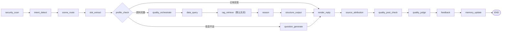

# gaobao-advisor — LangGraph AI 高考志愿咨询工程

[](https://github.com/Xander-Xai/gaobao-advisor/actions/workflows/ci.yml)
[](LICENSE)


**一个可复现的 AI Agent 工程样本**：LangGraph 有状态工作流、FastAPI / SSE、结构化数据查询、Vue 3，以及会话安全与失败关闭设计。

**3 分钟先跑 API 演示，无需模型 Key 或真实招生数据：**

```bash
git clone https://github.com/Xander-Xai/gaobao-advisor.git
cd gaobao-advisor
docker build -t gb-advisor .
docker run --rm -p 8000:8000 gb-advisor
# 在另一个终端执行：
curl http://localhost:8000/api/v1/health
curl "http://localhost:8000/api/v1/data/schools?limit=3"
```

> Docker 默认启动 **FastAPI 后端**，不会自动打开 Vue 前端。前端开发启动见[快速开始](#快速开始)。
> 演示数据为程序生成的虚构数据，**不能用于真实高考志愿决策**；知识库检索默认关闭。

**导航：** [核心能力](#这个仓库是什么不是什么) · [工程设计](#关键工程设计) · [架构](#架构) · [快速开始](#快速开始) · [演示步骤](TUTORIAL.md) · [数据与 RAG 边界](#数据分发模式) · [安全与贡献](#许可与合规)

一个基于 **LangGraph + 结构化高考数据查询 + FastAPI/SSE + Vue 3** 的 AI 志愿填报
顾问开源工程。它不是把问题直接丢给大模型的 ChatBot，而是把志愿咨询拆成
**画像采集 → 数据查询 → 知识检索（可选）→ 决策推理 → 来源标注 → 质量检查 →
多轮记忆** 的可观测工作流。

> **数据边界先行：** 本仓库默认只附带由程序生成的**合成演示数据**
> （`SYNTHETIC_DEMO`），不对应任何真实院校、专业或录取结果，不可用于真实
> 志愿决策。真实录取数据的导入能力保留在源码中，但需要使用者自行提供合法数据。

---

## 这个仓库是什么，不是什么

**是：** 一个把多轮对话、槽位抽取、结构化数据查询、LangGraph 编排、SSE 流式
输出和服务端会话鉴权组装在一起的工程样本。

**不是：** 一个附带真实知识库或真实招生数据的产品；也没有任何未经验证的
「企业级性能」或「RAG 质量」承诺。

| 能力 | 状态 | 说明 |
|---|---|---|
| 多轮对话与槽位抽取 | 可用 | LangGraph 状态机 + `slots/` 槽位契约 |
| 结构化数据查询（院校/专业/分数/位次/计划） | 可用 | 运行于数据源（默认合成库） |
| 冲/稳/保候选与一分一段 | 可用 | `legacy/` 适配层 + `db/` 模型 |
| 数据导入脚本 | 可用（自行提供数据） | `scripts/import_*.py`；第三方抓取默认关闭 |
| FastAPI + SSE + WebSocket 语音 | 可用 | 语音默认关闭，需自备 DashScope 凭据 |
| Vue 3 前端 | 可用 | `frontend/` |
| **知识库检索（RAG）** | **默认关闭** | 见下方「RAG 边界」 |
| 联网搜索 | 关闭 | 无第三方检索授权 |

---

## 关键工程设计

| 工程问题 | 采用的设计 | 查看实现 |
|---|---|---|
| 多轮咨询的信息不完整 | LangGraph 条件路由、槽位采集和追问分支 | [图定义](server/graph/graph.py) · [状态](server/graph/state.py) |
| LLM 与结构化业务数据如何协作 | 查询节点接入 SQLite/SQLAlchemy，后续生成与来源标注分离 | [数据 API](server/routes/data.py) · [图定义](server/graph/graph.py) |
| 可选 RAG 无语料时怎么办 | 显式 `RAG_DISABLED`，不可用时 fail-closed，不假装命中检索 | [RAG 服务](server/services/rag.py) |
| 匿名多轮会话如何隔离 | 服务端签发 session ID；后续请求使用 HMAC 绑定的 Bearer token | [鉴权](server/auth.py) · [SSE 聊天](server/routes/chat.py) |
| 如何验证仓库能实际运行 | 合成数据种子、无 Key Docker、Python/前端/安全 CI 门禁 | [CI](.github/workflows/ci.yml) · [验收测试](tests/test_public_demo_acceptance.py) |

**读代码顺序（面向 AI 应用工程实践）：** `server/graph/graph.py` → `server/graph/state.py` → `server/routes/chat.py` → `server/auth.py` → `server/services/rag.py`。这条路线比只看 API 列表更容易理解状态流转、异步流式输出与错误边界。

**真实性说明：** 工作流编排与 SSE 生成分开实现；当前图定义不包含独立的 `llm_reason` 节点，LLM token streaming 由 `server/routes/chat.py` 处理。项目没有已验证的吞吐量、SLA、真实录取准确率或 RAG 评测指标。

---

## 数据分发模式

默认模式开箱即用、可复现、无第三方授权风险：

1. **SYNTHETIC_DEMO（默认）** — `scripts/seed_demo_data.py` 由固定随机种子
   （`20240617`）生成，两次运行结果完全一致。院校名统一带「（合成）」，
   省份为虚构的「示例省·甲」等，`schools.special_type` 写入
   `SYNTHETIC_DEMO_DATA`。
   ```bash
   python -m scripts.seed_demo_data --db data/demo.db --reset
   ```
2. **USER_SUPPLIED_DATA** — 使用者自行准备并导入自己有权使用的数据。导入脚本见
   `scripts/import_*.py`。开启第三方抓取需显式设置 `ENABLE_OUTBOUND_FETCH=true`。
3. **VERIFIED_PUBLIC_DATA** — 有来源记录、公开使用边界已审查的数据
   （当前为 **PENDING**，未随仓库分发）。录取分数等客观事实是可公开候选，
   但需要逐项留存来源与使用条款，不能反推数据库备份、会话记录或语料可公开。

---

## RAG 边界（务必阅读）

上游私有工程的知识库语料**没有可确认的再分发授权**，因此本仓库**不附带语料**。
对此采取 **fail-closed（失败即关闭）** 策略，而不是静默降级：

* `ENABLE_RAG_KB=false`（默认），与运行时行为一致；
* `server/services/rag.py` 提供 `status()` / `is_available()`，语料不可用时
  检索请求**抛出 `RagDisabledError`**，而不是返回空列表假装「没检索到」；
* `rag_retrieve_node` 把状态写入图状态 `rag_state`；
* `/api/v1/health` 如实返回：

```json
{
  "status": "ok",
  "data_profile": "SYNTHETIC_DEMO",
  "optional_services": {
    "rag": {
      "state": "RAG_DISABLED",
      "reason": "ENABLE_RAG_KB is not enabled",
      "corpus_configured": false
    }
  },
  "degraded_services": ["rag"]
}
```

若要演示 RAG，请提供**原创且授权清晰**的语料，设置
`ENABLE_RAG_KB=true` 并通过 `rag.configure()` 显式配置；仅有开关而没有语料
仍然只会得到 `RAG_DISABLED`（`corpus_configured: false`），这是刻意设计。

---

## 安全规则资产（fail-closed）

`safety_rules.md` 是原创编写的通用咨询安全约束（不编造数据、标注来源、
不提供专业意见、防提示注入、合成数据声明等）。

`SkillService` 在 `skills/gaokao/safety_rules.md` 缺失或为空时抛出
`SkillAssetUnavailableError`，**拒绝生成答案**，而不是在没有安全约束的情况下
静默作答。负控制测试见 `tests/test_skill_service.py::TestFailClosed`。

提示注入防护独立于此：`server/middleware/security.py::detect_injection` 始终生效。

---

## 会话安全

* 首次匿名会话的 `session_id` 由服务端 `secrets.token_urlsafe` 生成，
  **忽略调用方传入的 `session_id`**；
* 继续会话必须携带与该 `session_id` 匹配的 `Authorization: Bearer <token>`；
* 令牌为 `HMAC-SHA256(SESSION_SECRET, session_id)`，不匹配即
  `422 Invalid session token`；不同会话不能复用令牌。

> 这是**会话能力令牌**，不是账号体系：没有密码、没有用户注册、没有跨设备
> 账号恢复。生产环境必须设置强随机 `SESSION_SECRET`。

---

## 架构



> 图示对应 [`server/graph/graph.py`](server/graph/graph.py) 注册的 17 个节点；LLM Token 流由 SSE 路由独立处理，不应误解为所有节点都在一次流式调用中执行。

核心技术栈：

| 层 | 技术 |
|---|---|
| 前端 | Vue 3 + Pinia + Vue Router + Tailwind CSS + Vite |
| API | FastAPI + Pydantic + SSE + WebSocket |
| Agent 编排 | LangGraph StateGraph |
| 数据库 | SQLite + SQLAlchemy |
| 知识检索 | Dense Embedding + Keyword Hybrid Retrieval（语料可选） |
| LLM | OpenAI Compatible API（DeepSeek / Qwen / GLM / Moonshot / GPT / Ollama） |
| 可观测性 | Prometheus + Sentry + Analytics |
| 部署 | Docker / Docker Compose + Nginx |

---

## 快速开始

### Docker（推荐，无需任何 Key）

```bash
docker build -t gb-advisor .
docker run --rm -p 8000:8000 gb-advisor
curl http://localhost:8000/api/v1/health
```

容器首次启动会在本地生成合成数据库，**镜像内不含任何数据库文件**。

### 本地

```bash
python -m venv .venv && source .venv/bin/activate
pip install -e ".[dev]"

# 生成合成数据
python -m scripts.seed_demo_data --db data/demo.db --reset

# 启动
uvicorn server.main:app --reload

# 前端
cd frontend && npm ci && npm run dev   # http://localhost:5173
```

### 测试

```bash
pytest tests -q --no-header        # Python 3.10 / 3.11
cd frontend && npx vitest run      # 前端单元测试
ruff check . && ruff format --check .
```

最近一次本地验证（本机 uv 托管环境；CI 在 Python 3.10 / 3.11 上运行同一套门禁）：

| 检查 | 结果 |
|---|---|
| `pytest tests` | **885 passed / 1 skipped**，覆盖率 **77.33%**（门禁 70%）|
| `ruff check` / `ruff format --check` | 通过 |
| `vitest run`（frontend）| **50 passed** |
| `npm run build`（frontend）| 通过 |
| Docker 无 Key 启动 `/api/v1/health` | `SYNTHETIC_DEMO` / `RAG_DISABLED` |

CI（`.github/workflows/ci.yml`）在 push / PR 上运行同一组门禁：Lint、Test（3.10 & 3.11）、
Secret Scan（gitleaks 全历史）、Security Audit（pip-audit + npm audit）、
Frontend Quality Gate、No-Key Container Smoke Test、Redistribution Gate。
门禁失败即红，不通过跳过或降低阈值来「修绿」。

---

## 项目结构

```text
server/
  main.py              FastAPI 入口（挂载 8 个路由）
  auth.py              会话令牌签发与校验（HMAC-SHA256）
  routes/              health / onboarding / chat / profile / data / knowledge / voice
  report/              报告生成路由
  graph/               LangGraph 编排与 17 个节点
  services/            rag / kb_retriever / quality / llm_router ...
  middleware/          CSP、限流、注入检测
db/                    SQLAlchemy 模型与会话
skills/gaokao/         SkillService（fail-closed）+ 原创安全规则与启发式
quality/               质量与幻觉检查
legacy/                数据查询适配层
scrapers/              数据采集器（默认不发起外部请求）
scripts/               数据导入脚本 + seed_demo_data.py
frontend/              Vue 3 + Vite（Chat / Report / Profile / Admin 四个视图）
tests/                 单元与验收测试（885 passed / 1 skipped）
```

---

## 已知限制与不适用场景

本工程是**可运行的开源工程样本**，不是可直接上线的生产系统，也不是志愿决策依据。
请明确以下边界：

* **数据**：默认只有程序生成的合成数据，**不用于真实志愿填报决策**。真实录取数据需
  由使用者自行准备、导入并确保拥有合法授权；`VERIFIED_PUBLIC_DATA` 当前仍为
  **PENDING**，未随仓库分发。
* **知识检索**：RAG 默认关闭，**不附带任何知识库语料**；只有开关而无授权语料时，
  健康检查仍返回 `RAG_DISABLED`。
* **联网能力**：第三方抓取（`ENABLE_OUTBOUND_FETCH`）与联网搜索（`ENABLE_SEARCH`）
  默认关闭。
* **身份体系**：只有「会话能力令牌」（HMAC 签名），没有账号、密码、注册、跨设备
  恢复；多 worker 部署必须显式设置 `SESSION_SECRET`。
* **语音**：WebSocket 语音链路默认关闭，需自备 DashScope 凭据。
* **生产级验证**：未做容量、并发、SLA 或真实 RAG 质量评测；可观测性组件
  （Prometheus / Sentry）需自行配置后才生效。
* **第三方数据再分发**：第三方招生数据存在授权不确定性，本仓库**不**再分发这类数据。

> 说明：以上是不适用边界，不是待办列表。历史版本中曾尝试过的人物化/营销类内容
> 已从当前源码树移除。

---

## 演示和参与

- **初次使用：** [无 Key 演示教程](TUTORIAL.md)；[合成模式演示检查项](examples/demo_conversation.md)。不提供真实院校报考推荐样例。
- **反馈问题：** [提交 Issue](https://github.com/Xander-Xai/gaobao-advisor/issues/new/choose)。请不要附加真实考生个人信息或 API Key。
- **贡献代码：** 参见 [CONTRIBUTING.md](CONTRIBUTING.md)。涉及安全问题请按 [SECURITY.md](SECURITY.md) 私下报告。
- **工程决策：** [ADR-002 LangGraph](docs/superpowers/adr/ADR-002-langgraph-flow.md)、[ADR-003 数据库](docs/superpowers/adr/ADR-003-sqlite-wal-joinedload.md)。

不提供承诺运行中的在线 Demo 服务；以仓库代码和最新 CI 为准。

---

## 许可与合规

* 代码：[`LICENSE`](LICENSE)（MIT）。
* 来源：本项目基于早期的 **MIT 许可代码**继续开发，并在此基础上独立完成了 LangGraph / FastAPI / Vue 3 / 容器化 / 会话安全 / 自动化测试等工程重构。完整来源、固定版本与后续许可证变更说明见 [`THIRD_PARTY_NOTICES.md`](THIRD_PARTY_NOTICES.md)；原始 MIT 版权声明与许可正文见 [`LICENSE`](LICENSE)。
* 数据：[`DATA_LICENSE.md`](DATA_LICENSE.md) — 合成数据集以 CC0-1.0 提供。
* 隐私：[`PRIVACY.md`](PRIVACY.md)。安全：[`SECURITY.md`](SECURITY.md)。
* 第三方：[`THIRD_PARTY_NOTICES.md`](THIRD_PARTY_NOTICES.md)；贡献指南：[`CONTRIBUTING.md`](CONTRIBUTING.md)。

**商标与人物：** 本项目不包含、也不声称包含任何真实人物的观点、方法论、
表达风格或语录；相关私有资产已在上游工程中移除。
