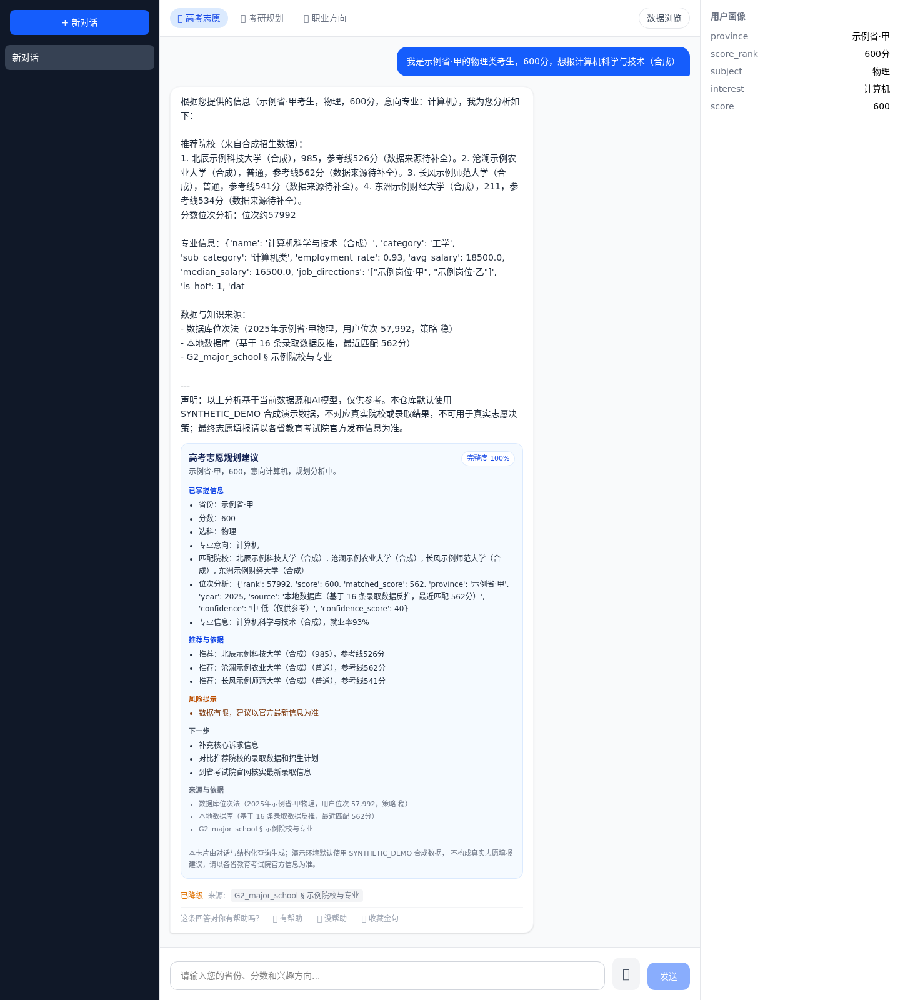
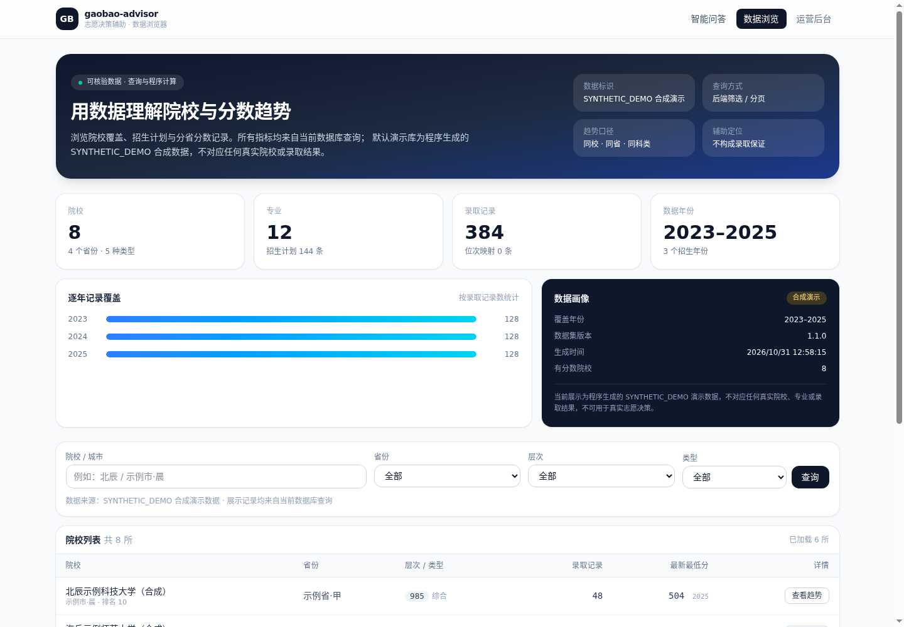
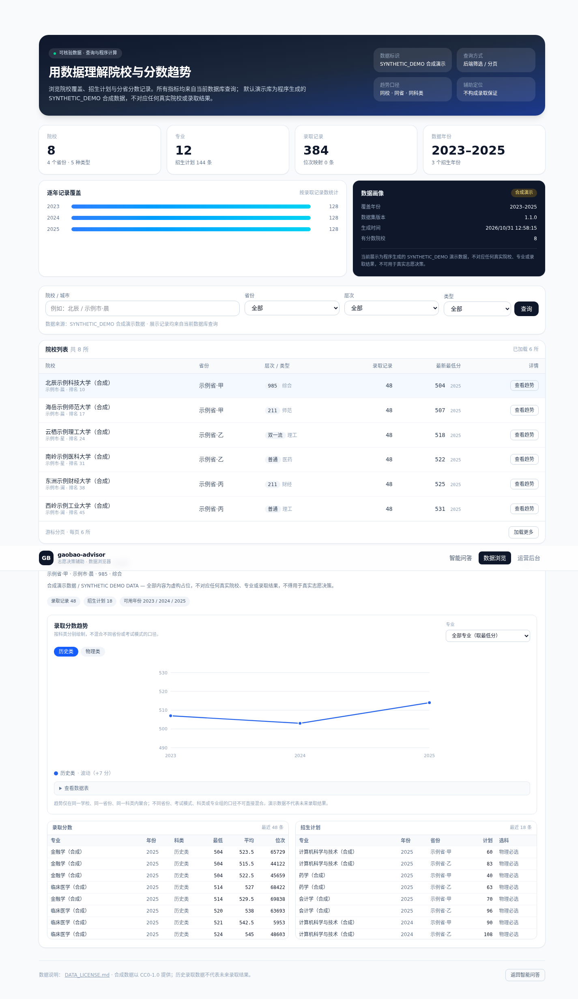
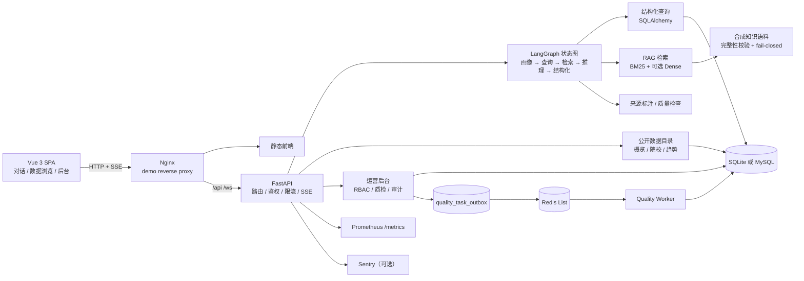

# gaobao-advisor

**AI-Powered College Application Decision Support**

基于 **LangGraph、RAG 与多源招生数据**构建的智能高考志愿辅助决策系统。项目把志愿咨询拆成可观测的工作流：多轮考生画像 → 结构化招生数据查询 → 知识检索 → 决策推理 → 来源标注 → 质量检查 → 会话记忆，并通过 Vue 3 提供对话、数据浏览与结构化推荐展示。

> **数据边界先行：** 仓库默认只附带程序生成的 **SYNTHETIC_DEMO** 合成演示数据，不对应任何真实院校、专业或录取结果，**不可用于真实志愿决策**。真实数据导入能力保留在源码中，使用者需自行提供合法授权数据。

[](https://github.com/Xander-Xai/gaobao-advisor/actions/workflows/ci.yml)
[](https://github.com/Xander-Xai/gaobao-advisor/actions/workflows/codeql.yml)
[](LICENSE)
[](DATA_LICENSE.md)


**目录：** [项目预览](#项目预览) · [核心功能](#核心功能) · [系统架构](#系统架构) · [技术栈](#技术栈) · [快速开始](#快速开始) · [数据说明](#数据说明) · [功能演示](#功能演示) · [开发与测试](#开发与测试) · [已知限制](#已知限制) · [Roadmap](#roadmap) · [License](#license)

---

## 项目预览

### 智能问答与结构化推荐

输入考生省份、分数、选科与专业意向后，系统完成多轮画像、结构化数据查询与知识检索，并返回可核验的推荐卡片（事实、建议、风险、下一步与来源分离展示）。



### 招生数据浏览器

数据概览、院校筛选、分省分数记录与按科类分离的趋势图。所有数字均来自当前数据库查询或构建阶段计算，不在前端硬编码。

| 数据概览 | 院校详情与趋势 |
|---|---|
|  |  |

---

## 核心功能

| 能力 | 状态 | 说明 |
|---|---|---|
| 多轮对话与考生画像 | **Available** | LangGraph 状态机 + 槽位抽取 + 持久化画像；缺失信息进入追问分支 |
| 结构化招生数据查询 | **Available** | 院校、专业、录取分数、位次、招生计划；默认运行合成库 |
| 冲 / 稳 / 保候选 | **Available** | 位次法与分数法适配层，结果附带数据来源与风险提示 |
| RAG 知识检索 | **Available** | 默认启用随仓原创合成语料；BM25 离线可用；带 `chunk_id` / `source` 引用 |
| 检索失败关闭 | **Available** | 语料缺失、损坏或未标记时返回 `RAG_ERROR` / 503，不静默编造答案 |
| SSE 流式对话 | **Available** | 槽位、结构化结果、来源、降级与 token 事件分离 |
| 匿名会话安全 | **Available** | 服务端签发 session ID；后续请求使用 HMAC Bearer token |
| 结构化推荐卡片 | **Available** | 事实、建议、风险、下一步、来源分区展示 |
| 公开数据浏览器 | **Available** | 概览、筛选、游标分页、院校详情、分科类趋势图 |
| 运营后台 | **Available** | 管理员 RBAC、数据质检、审核、审计与可选 Redis Worker |
| MySQL + Redis + Worker | **Available**（可选 profile） | Alembic 迁移、事务 Outbox、租约恢复与审计 |
| Dense Embedding 检索 | **Experimental** | 需显式配置 embedding provider；默认离线 BM25 |
| 语音交互 | **Experimental** | 默认关闭，需自备 DashScope 凭据 |
| 第三方实时联网检索 | **Planned** | 默认关闭；无第三方抓取授权 |

**不是：** 不是附带真实招生数据库的产品，不是多智能体系统，也没有未经验证的招生准确率、用户量或 SLA 承诺。当前只有一个 LangGraph 状态图；没有为了架构图更复杂而增加 Agent。

---

## 系统架构



完整组件依赖、在线问答时序、LangGraph 状态流、RAG 链路、数据流与部署拓扑见 **[docs/architecture/README.md](docs/architecture/README.md)**。

---

## 技术栈

| 层 | 实际使用 |
|---|---|
| Frontend | Vue 3、Vite、Pinia、Vue Router、Tailwind CSS；运营后台模块使用 TypeScript |
| Backend | FastAPI、Pydantic、SSE（`sse-starlette`）、WebSocket（可选语音） |
| Agent 编排 | LangGraph `StateGraph`，17 个节点，单状态图 |
| 数据库 | SQLite（默认）、MySQL 8.4（可选）、SQLAlchemy 2、Alembic |
| 知识检索 | 自研 BM25 关键词检索；可选 embedding provider + Dense 检索 |
| LLM | OpenAI-compatible API（DeepSeek / Qwen / GLM / Moonshot / OpenAI / Ollama） |
| 异步任务 | Redis List + 事务 Outbox + 独立 Worker（可选） |
| 可观测性 | Prometheus 指标、Sentry（可选）、结构化审计日志 |
| 部署 | Docker、Docker Compose、Nginx |
| 测试 / CI | pytest、Vitest、vue-tsc、Ruff、GitHub Actions、CodeQL、gitleaks、pip-audit、npm audit |

---

## 快速开始

### 方式一：Docker Compose（推荐，无需 LLM Key）

要求：Docker 24+ 与 Compose v2。

```bash
git clone https://github.com/Xander-Xai/gaobao-advisor.git
cd gaobao-advisor
docker compose up --build
```

启动后访问：

| 入口 | 地址 |
|---|---|
| 应用（Nginx，含 API 代理） | http://localhost |
| 数据浏览器 | http://localhost/data |
| 运营后台 | http://localhost/admin |
| API 健康检查 | http://localhost:8000/api/v1/health |
| API 文档 | http://localhost:8000/docs |

> `:3080` 只提供静态前端资源；要让 `/api` 正常转发，请使用 `http://localhost`（Nginx）。
> 容器首次启动会生成确定性的合成 SQLite 数据库；镜像内不包含数据库文件。

验证：

```bash
curl -s http://localhost:8000/api/v1/health
curl -s "http://localhost:8000/api/v1/data/overview"
curl -s -X POST http://localhost:8000/api/v1/knowledge/search \
  -H 'Content-Type: application/json' \
  -d '{"query":"平行志愿的投档规则是什么"}'
```

健康检查应显示 `data_profile: SYNTHETIC_DEMO` 与 `rag.state: RAG_ENABLED`。

停止：

```bash
docker compose down          # 保留数据卷
docker compose down -v       # 同时删除演示数据卷
```

### 方式二：本地开发

要求：Python 3.10 / 3.11、Node.js 20。

```bash
python -m venv .venv
source .venv/bin/activate
pip install -e ".[dev]"

# 生成合成演示库（3 个学年，固定随机种子）
python -m scripts.seed_demo_data --db data/demo.db --reset
export DATABASE_URL=sqlite:///data/demo.db

# 启动 API（http://localhost:8000）
uvicorn server.main:app --reload
```

另开终端启动前端：

```bash
cd frontend
npm ci
npm run dev        # http://localhost:3080/data
```

Vite 开发服务器会把 `/api` 代理到 `http://127.0.0.1:8000`。

### 可选：启用 LLM

不配置 Key 时，完整画像路径会返回基于结构化查询的确定性模板，并在 SSE 中标记 `degraded`。配置后走模型流式生成：

```bash
export OPENAI_API_KEY=...
export OPENAI_API_BASE=https://api.openai.com/v1
export LLM_MODEL=gpt-4o-mini
uvicorn server.main:app --reload
```

模型输出仍会附加合成数据声明；RAG 语料缺失时不会用模型答案掩盖检索故障。

### 可选：MySQL + Redis + Worker

```bash
python scripts/setup_full_env.py          # 生成 .env.full（0600，已 gitignore）
docker compose --env-file .env.full \
  -f docker-compose.yml -f docker-compose.full.yml --profile full up --build
```

该 profile 启动 FastAPI（MySQL + Alembic）、MySQL 8.4、Redis 7、Quality Worker、前端与 Nginx。MySQL/Redis 不发布宿主机端口。

---

## 数据说明

### 随仓库分发：SYNTHETIC_DEMO

`scripts/seed_demo_data.py` 由固定随机种子 `20240617` 生成，可重复执行：

```bash
python -m scripts.seed_demo_data --db data/demo.db --reset
```

当前演示集包含：

- 8 所虚构院校、12 个虚构专业；
- 最近三个完整学年的录取分数、招生计划与学科排名；
- 每所院校带 `（合成）` 标记，`schools.special_type = SYNTHETIC_DEMO_DATA`；
- `dataset_snapshots` 表记录数据集版本、来源说明、生成时间与覆盖年份；
- 知识语料位于 `knowledge/synthetic_demo/`，带 `SYNTHETIC_DEMO` 标记与 sha256 清单。

数据浏览页的院校数、专业数、录取记录数、年份范围、覆盖情况与生成时间均由数据库查询或种子元数据计算，不使用前端假数字。趋势图只在**同一学校、同一省份、同一科类**内聚合，不把不同省份或考试模式混成一条曲线。

### 使用者自有数据

真实录取数据可通过 `scripts/import_*.py` 导入，但仓库**不分发**真实招生数据库、第三方知识语料或历史私人会话。数据来源、授权、准确性与再分发权限由部署者自行负责。导入后 `data_profile` 会如实显示 `CUSTOM` 或 `MIXED`，不会继续标记为合成数据。

### 使用边界

历史录取分数不代表未来录取结果。合成数据不对应任何真实院校或专业，不可用于真实志愿决策。完整数据许可与来源说明见 **[DATA_LICENSE.md](DATA_LICENSE.md)**。

---

## 功能演示

1. 打开 http://localhost ，输入：

   > 我是示例省·甲的物理类考生，600分，想报计算机科学与技术（合成）

2. 观察 SSE 返回：`slots`（画像）→ `structured`（结构化卡片）→ `sources`（RAG 引用）→ `token` → `done`。
3. 卡片区分「已掌握信息 / 推荐与依据 / 风险提示 / 下一步 / 来源」，并明确标注不构成录取保证。
4. 打开 http://localhost/data ：
   - 查看数据覆盖与来源；
   - 按省份、层次、类型筛选院校；
   - 进入院校详情，选择科类查看三年录取趋势；
   - 查看录取分数与招生计划明细。

命令行演示与可复现脚本见 **[TUTORIAL.md](TUTORIAL.md)**。

API 示例：

```bash
# 院校列表（游标分页）
curl -s "http://localhost:8000/api/v1/data/schools?limit=3"

# 数据概览
curl -s "http://localhost:8000/api/v1/data/overview"

# 分科类趋势（不会混合科类）
curl -s "http://localhost:8000/api/v1/data/trends?school_name=北辰示例科技大学（合成）&province=示例省·甲"
```

---

## 项目结构

```text
server/
  main.py            FastAPI 入口、中间件与路由挂载
  routes/            chat / data / health / knowledge / profile / report / voice
  graph/             LangGraph 状态图、状态契约与 17 个节点
  services/          RAG、数据目录、模型路由、质量与语音
  admin/             管理员 RBAC、质检任务、审计、Redis 队列与 Worker
  domain/            Pydantic 领域/接口模型
db/                  SQLAlchemy 模型、会话、分页与 schema contract
migrations/          Alembic 版本
scripts/             合成数据生成、导入与本地运维脚本
knowledge/           随仓合成知识语料（SYNTHETIC_DEMO）
frontend/src/        Vue 3 页面、组件、Pinia stores 与 API client
tests/               Python 单元 / 集成 / 验收测试
docs/                architecture、ADRs、security、performance、governance
```

---

## 开发与测试

### 常用命令

```bash
# Python
pytest tests/ -q
ruff check . && ruff format --check .

# 前端
cd frontend
npm ci
npm test -- --run        # vue-tsc + vitest
npm run build

# 可选集成测试（一次性 MySQL 8.4 + Redis 7）
make test-integration
```

### CI 门禁

GitHub Actions 在 push / PR 上运行：

- Lint（Ruff）；
- Python 3.10 / 3.11 全量测试与覆盖率门禁；
- MySQL 8.4 + Redis 7 集成测试、Admin Smoke、迁移与队列恢复；
- 前端 `vue-tsc` + Vitest + Vite build；
- 无 Key 容器启动与健康检查；
- Full Compose E2E；
- CodeQL（Python / JavaScript-TypeScript）；
- gitleaks 全历史扫描、敏感文件守卫；
- pip-audit、npm audit；
- 合成数据再分发 Gate。

分支保护要求上述检查通过；失败不会通过降低阈值或跳过测试来“修绿”。CI 结果以仓库 Actions 页面为准。

---

## 已知限制

- **数据**：默认只有合成数据，不适用于真实志愿填报；真实数据导入能力和数据授权由部署者负责。
- **模型**：LLM 输出可能出错；无 Key 时为确定性模板，不等同于模型推理能力。
- **实时性**：不提供官方实时招生数据；第三方抓取与联网搜索默认关闭。
- **检索**：默认 BM25；Dense 检索需要显式配置 provider。合成语料规模小，不构成生产级 RAG 质量证明。
- **身份**：匿名会话使用 HMAC 能力令牌，无账号体系、密码找回或跨设备同步。
- **架构**：单 LangGraph 状态图，不是多智能体系统；MySQL/Redis/Worker 为可选 profile，不承诺生产 SLA。
- **生产部署**：仓库包含容器与 Compose 配置，但未声明可直接承载公网生产流量。

安全边界与漏洞报告方式见 **[SECURITY.md](SECURITY.md)**；隐私说明见 **[PRIVACY.md](PRIVACY.md)**。

---

## Roadmap

- 增加带来源登记与授权检查的公开数据导入适配器；
- 为匿名会话增加可过期 / 可撤销令牌；
- 扩展 RAG 评测集与引用覆盖率检查；
- 改进数据浏览器的移动端与无障碍体验。

不把未实现的能力写成已上线；新功能进入 `Planned` 前先补测试与数据来源说明。

---

## 贡献

- 提交 Issue 前请确认不包含真实考生个人信息、API Key 或未授权数据；
- 代码贡献见 **[CONTRIBUTING.md](CONTRIBUTING.md)**；
- 安全问题请按 **[SECURITY.md](SECURITY.md)** 私下报告；
- 第三方依赖与来源见 **[THIRD_PARTY_NOTICES.md](THIRD_PARTY_NOTICES.md)**。

## License

- **代码**：[MIT](LICENSE)。
- **随仓合成数据与合成知识语料**：[CC0-1.0](DATA_LICENSE.md)。
- **第三方依赖**：各自许可证见 [THIRD_PARTY_NOTICES.md](THIRD_PARTY_NOTICES.md)。

代码开源许可证不自动覆盖使用者自行导入的第三方招生数据或语料。
