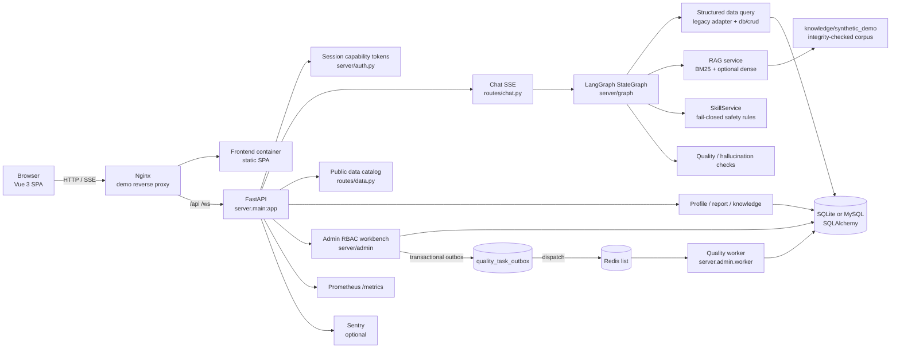
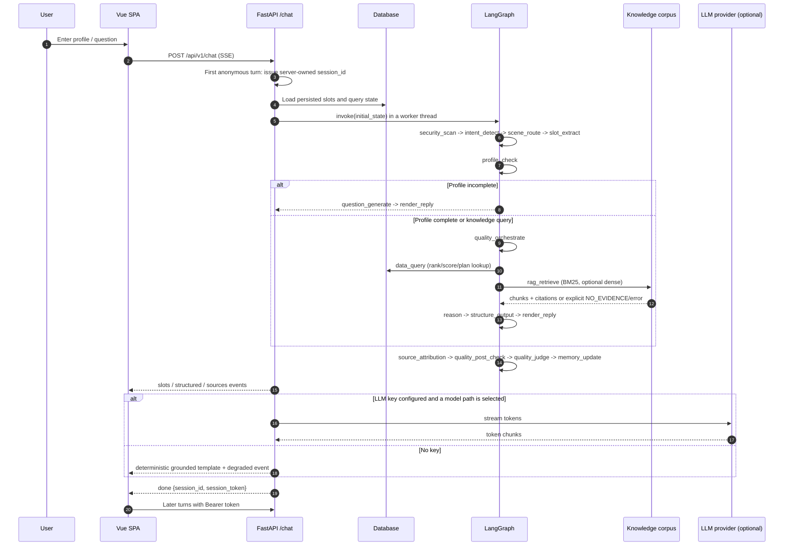
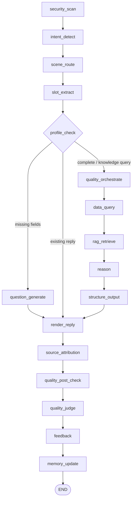
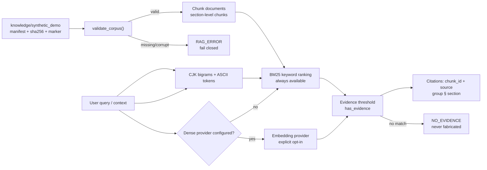
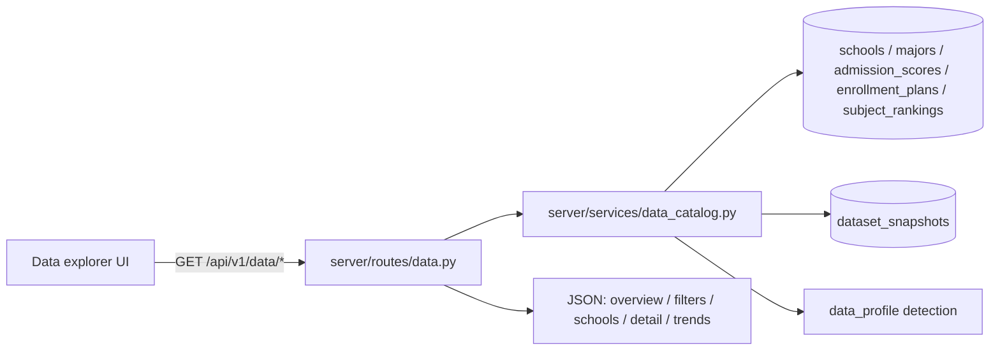
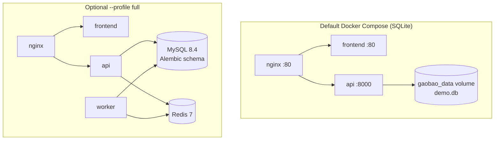

# Architecture

This document is the authoritative architecture reference for
`gaobao-advisor`. It describes the code that ships in this repository, not a
future design. The ADRs under [`docs/superpowers/adr/`](../superpowers/adr/)
record why the larger decisions were made.

## 1. System overview

`gaobao-advisor` is a read/write web application with four runtime roles:

1. **Vue 3 SPA** — chat, structured recommendation cards, public data explorer,
   profile/report views, and the administrator workbench.
2. **FastAPI application** — HTTP/SSE/WebSocket transport, session capability
   tokens, request correlation, rate limiting, and API error envelopes.
3. **LangGraph advisor graph** — deterministic orchestration of security scan,
   intent/scene routing, slot extraction, profile checks, structured data
   queries, RAG retrieval, reasoning, structured output, source attribution and
   quality checks.
4. **Optional worker** — consumes data-quality jobs from Redis and writes
   findings to the database.

The default deployment uses SQLite and no LLM key. The optional full profile
adds MySQL 8.4, Redis 7, and a separate worker.



### Layer responsibilities

| Layer | Path | Responsibility |
|---|---|---|
| API / transport | `server/main.py`, `server/routes/`, `server/admin/routes.py` | Routing, validation, auth entry points, response/error shape, SSE framing |
| Application | `server/graph/`, `server/services/`, `server/admin/service.py` | Use cases, graph orchestration, query composition, transaction boundaries |
| Domain | `server/domain/`, `slots/`, `quality/` | Slot/profile rules, structured recommendation contract, quality rules |
| Infrastructure | `db/`, `legacy/`, `server/services/llm_router.py`, `server/services/kb_retriever.py`, `server/admin/queue.py` | Persistence, model providers, retrieval, queue, external adapters |

The codebase is being migrated incrementally to this shape. New read models
(for example the public data catalog) live behind a service; older modules
(`legacy/gaokao_data.py`, `db/crud.py`) remain as adapters for compatibility.

## 2. Online Q&A flow



Important invariants:

* An anonymous first request always gets a **server-generated** session ID. A
  caller-supplied ID cannot mint a token (regression test:
  `tests/test_public_demo_acceptance.py::TestSessionIdentity`).
* The database is the source of truth for a persisted profile; stale client
  slots only fill unknown keys.
* The graph stops before model streaming. Token streaming is handled by
  `server/routes/chat.py`; the template reply is the offline/failure fallback.
* RAG failures are explicit (`RAG_ERROR` / `NO_EVIDENCE` / `RAG_DISABLED`), not
  silently converted into an answer without evidence.

## 3. LangGraph state flow

The compiled graph is defined in `server/graph/graph.py`; the state contract is
`server/graph/state.py`.



State channels include slots/profile snapshot, RAG chunks/evidence/sources, data
query results, structured result, reply/reply source, quality scores, retrieval
state and the persisted `_query_state` used by the follow-up question engine.

## 4. RAG retrieval chain

`server/services/rag.py` owns corpus lifecycle; the retrieval engine is
`server/services/kb_retriever.py`.



The shipped corpus is original synthetic material. A corpus without the
`SYNTHETIC_DEMO` marker, a bad hash, a missing file, or a symlink is rejected.
Network embedding providers are only used when explicitly configured; an LLM
key alone does not enable them.

## 5. Data processing and public data catalog

### Demo data

`scripts/seed_demo_data.py` is a pure, deterministic generator (fixed seed
`20240617`). It creates:

* 8 fictional schools, 12 fictional majors;
* three synthetic admission years (the most recent three complete years);
* admission scores, enrollment plans and subject rankings;
* a `dataset_snapshots` row with version, profile, generation time and year
  range.

Every school carries `special_type = SYNTHETIC_DEMO_DATA` and `（合成）` in its
name. The seed is idempotent for a non-empty database; `--reset` recreates a
SQLite demo.

### Public read model



The public catalog never touches administrator review, audit, revocation or
quality-job tables. It exposes aggregates, bounded school detail and trends.
Trends are grouped by subject type and never mix provinces, exam modes or
subject types into one line. `GET /api/v1/data/schools` keeps the original
cursor-based contract; `q`, `province`, `level`, `school_type` and `total` are
additive.

### Database schema ownership

* SQLite demo: `db.database.init_db()` uses `Base.metadata.create_all`.
* MySQL: Alembic migrations in `migrations/versions/`; the container entrypoint
  runs `python -m db.migrate` before starting the API.
* `db/schema_contract.py` derives table/column/index/FK expectations from the
  ORM and is used by MySQL adoption/migration tests.

## 6. Redis / worker task flow

The queue is deliberately small: one queue, one job type, job IDs only.

```mermaid
sequenceDiagram
    autonumber
    participant Admin as Admin workbench
    participant API as FastAPI admin routes
    participant DB as Database
    participant Outbox as quality_task_outbox
    participant Redis as Redis list
    participant Worker as Quality worker

    Admin->>API: POST /api/v1/admin/quality/jobs
    API->>DB: create job (PENDING)
    API->>Outbox: insert outbox row (same transaction)
    API->>DB: commit
    API->>Redis: best-effort dispatch
    alt Redis unavailable in async mode
        API-->>Admin: 202 PENDING + warning (not success)
    else dispatched
        API-->>Admin: 202/200 job id
    end
    Worker->>Redis: BRPOP job id
    Worker->>DB: atomic claim PENDING -> RUNNING with attempts fencing
    Worker->>DB: collect deterministic issues, complete job
    Worker->>DB: audit event + issue rows
    Worker->>Redis: next job
    Note over Worker,DB: Startup/periodic scan recovers stale RUNNING and orphaned DISPATCHED jobs. Delivery is at-least-once; the unique issue constraint and claim fencing absorb duplicates.
```

`KEEP_LIST` is the documented delivery decision (ADR-009). The database, not
Redis, is the state source of truth. Recovery is lease-based (60s delivery /
600s execution by default), not an exactly-once guarantee.

## 7. Deployment topology



MySQL and Redis are not published to the host in the full profile; services use
the Compose network. Production TLS configuration is separate from the HTTP-only
demo proxy.

## 8. Source map

| Concern | Authoritative path |
|---|---|
| API entry point / middleware | `server/main.py`, `server/middleware/` |
| Chat SSE and session issuance | `server/routes/chat.py`, `server/auth.py` |
| LangGraph graph/state/nodes | `server/graph/graph.py`, `state.py`, `nodes/` |
| Slot extraction and persistence | `slots/`, `server/graph/nodes/extract.py`, `memory.py` |
| Structured recommendation | `server/graph/nodes/structure.py`, `server/domain/schemas.py`, `frontend/src/components/chat/StructuredCard.vue` |
| RAG corpus and retrieval | `server/services/rag.py`, `kb_retriever.py`, `knowledge/synthetic_demo/` |
| Public data catalog | `server/routes/data.py`, `server/services/data_catalog.py`, `server/domain/data_catalog.py` |
| Admin RBAC / quality / audit | `server/admin/` |
| Queue and worker | `server/admin/queue.py`, `server/admin/worker.py` |
| Persistence / migrations | `db/`, `migrations/versions/` |
| Demo dataset generator | `scripts/seed_demo_data.py` |
| Data explorer UI | `frontend/src/views/DataView.vue`, `components/data/` |
| Tests / CI | `tests/`, `frontend/src/**/__tests__/`, `.github/workflows/` |

## 9. Public API surface

| Method | Path | Purpose | Auth |
|---|---|---|---|
| GET | `/api/v1/health` | Liveness + DB/RAG state + data profile | Public |
| GET | `/api/v1/health/live` | Process liveness | Public |
| GET | `/api/v1/health/ready` | DB readiness (503 when down) | Public |
| POST | `/api/v1/chat` | SSE chat turn | Anonymous first turn; Bearer for continuation |
| GET | `/api/v1/data/overview` | Data coverage/provenance | Public |
| GET | `/api/v1/data/filters` | Filter values in the database | Public |
| GET | `/api/v1/data/schools` | School search + cursor pagination | Public |
| GET | `/api/v1/data/schools/{id}` | School detail + bounded samples | Public |
| GET | `/api/v1/data/scores` | Score rows | Public |
| GET | `/api/v1/data/plans` | Enrollment plans | Public |
| GET | `/api/v1/data/trends` | Subject-separated score trend | Public |
| POST | `/api/v1/knowledge/search` | RAG evidence search | Public |
| GET/PUT | `/api/v1/profile/{session_id}` | Persisted profile | Session Bearer |
| POST | `/api/v1/report/generate` | Report generation | Session Bearer |
| `/api/v1/admin/*` | — | RBAC operations workbench | Admin Bearer |

The full generated schema is available at `/docs` when the API is running.

## 10. Key decisions and ADR index

| ADR | Decision |
|---|---|
| [ADR-001](../superpowers/adr/ADR-001-fastapi-migration.md) | FastAPI transport |
| [ADR-002](../superpowers/adr/ADR-002-langgraph-flow.md) | LangGraph state machine; no extra agent layer |
| [ADR-003](../superpowers/adr/ADR-003-sqlite-wal-joinedload.md) | SQLite WAL and eager loading |
| [ADR-004](../superpowers/adr/ADR-004-hybrid-rag.md) | BM25-first hybrid retrieval, fail-closed corpus |
| [ADR-005](../superpowers/adr/ADR-005-voice-integration.md) | Optional voice integration |
| [ADR-006](../superpowers/adr/ADR-006-adr-process.md) | ADR process |
| [ADR-007](../superpowers/adr/ADR-007-admin-workbench-rbac.md) | Admin workbench RBAC and audit |
| [ADR-008](../superpowers/adr/ADR-008-mysql-redis-worker.md) | Optional MySQL/Redis/worker profile |
| [ADR-009](../superpowers/adr/ADR-009-redis-delivery-selection.md) | Keep Redis List + Outbox as delivery mechanism |

## 11. Boundaries

* The demo is not a production admissions decision system; synthetic data must
  not be used for real applications.
* The graph is intentionally a single state machine. Adding agents requires a
  demonstrated need, not a diagram preference.
* Multi-worker deployments need an explicit `SESSION_SECRET`; anonymous
  sessions are capability tokens, not an account system.
* Public data endpoints are rate-limited by the application middleware, but the
  demo does not claim a production-grade anti-abuse or SLA posture.
